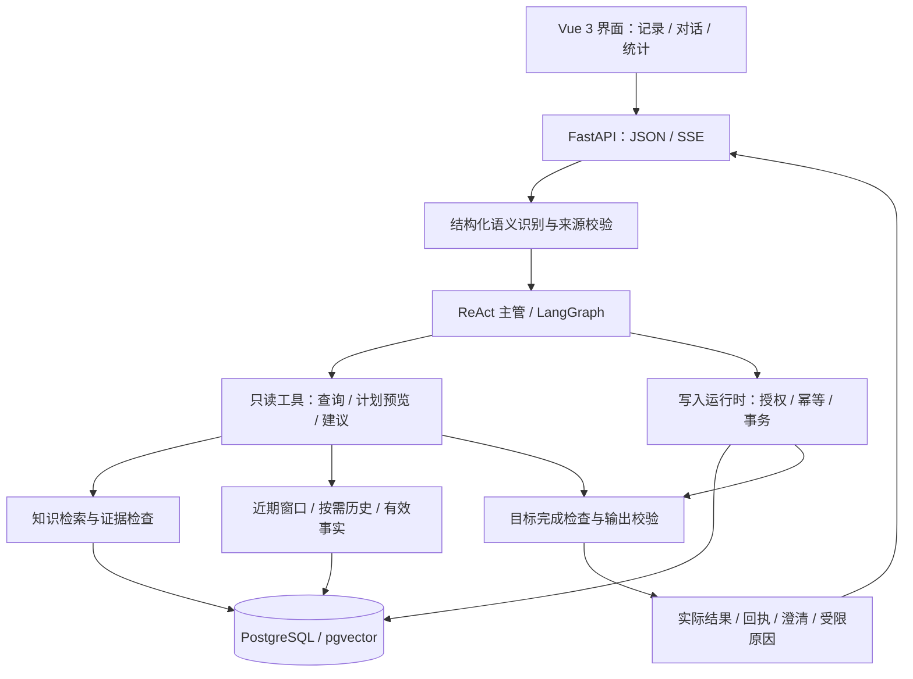

# FitZen 健身助手

[](https://github.com/ltczdw/fitzen-fitness-assistant/actions/workflows/checks.yml)
[](LICENSE)

一个面向个人训练与饮食管理的 AI Agent 应用，使用 **Vue 3 + FastAPI + PostgreSQL / pgvector**，将自然语言对话、训练记录、营养计算、知识检索和多轮计划调整放在同一套工作流里。

一条“帮我记录昨天的训练，再安排今天的饮食”，需要同时解决任务拆分、日期理解、可靠保存、历史约束和有依据的建议。FitZen 围绕这些实际问题实现了三部分：

- **执行**：ReAct 主管调用查询、记录、计划和建议工具，逐目标检查完成状态；保存由数据库事务与回执确认。
- **记忆**：最近对话提供连续性，更早历史按需读取；长期事实、临时条件和计划预览分别管理来源与有效范围。
- **证据**：检索结果绑定原文与适用条件，区分冲突、条件差异和证据不足，让回答有可核对的依据。

当前是**本地单用户原型**，尚无身份认证。适合个人本地使用与 Agent 工程实践，不能直接作为公网多用户服务部署。

## 能做什么

| 场景 | 当前能力 |
| --- | --- |
| 训练记录 | 动作、逐组重量与次数、日期、体感，以及编辑、删除和统计 |
| 饮食记录 | 食物查表、份量计算、餐次记录与营养汇总 |
| 对话式保存 | 从用户原文提取记录，缺项时澄清，按真实提交结果返回回执 |
| 已保存记录更正 | 在来源可定位时更正上一条训练的动作名，保留日期、重量、组次与记录 ID |
| 训练安排 | 根据已确认条件生成预览，支持继续补充、修改或取消待完成目标 |
| 健身与饮食问答 | 结合个人约束与知识检索给出建议，展示引用及证据限制 |
| 个人记忆 | 保存有来源的事实与约束，处理临时条件、版本变化及历史冲突 |

以下是可尝试的输入示例，不代表每次模型调用都能成功：

```text
帮我记录昨天哑铃推胸 15*8*4，再给我安排今天的饮食
说错了，是哑铃卧推
给我制定三分化训练计划
是居家训练，只有一对哑铃
我对花生过敏，帮我记住
我对什么过敏？
```

记录中省略次数和组数单位时，`15*8*4` 按重量 × 次数 × 组数理解；自重动作也支持记录。动作名或目标记录无法唯一确定时继续澄清。训练计划未指定器械时默认健身房，明确的居家、徒手或器械限制优先；默认不追问时长，也不展示时间表，用户需要时再安排。

## 架构



主管负责选择工具和推进目标，应用负责验证来源、权限、参数、预算及数据库结果。查询、计划预览与建议是只读能力；写入走独立的受控运行时。`plan_training` 生成预览，不因此获得保存正式计划的权限。

JSON 与 SSE 共用业务执行器；SSE 在完整输出校验后分块发送。模型不可用、输出无效或必要条件不足时，返回相应受限状态。项目保留 legacy 兼容路径，路由开关和离线配置见[安装说明](docs/getting-started.md)。

## 记忆与上下文

### 最近 10 轮 + 按需历史

默认先加载本会话最近 **10 轮**有效对话，供路由理解“是弯举”“改成二分化”“重新生成”等追问。一轮是用户输入及其助手回复，不包含工具日志。

- 近期正文预算为 **12,000 tokens**，按最新优先装入完整问答；超出容量的轮次记录为省略，原文仍可按需读取。
- 更早内容通过 Wiki 目录选择来源，只读取当前目标相关的历史及其依赖。
- 已加载且版本一致的来源复用，按消息 ID 去重；隐藏、删除、跨会话或版本变化会阻断不再有效的引用。
- 默认窗口服务于路由理解，每个生成任务只接收它选中的来源与必要条件。

历史原文用于理解和取证，不能自动授予本轮保存权限。失败回复也不会覆盖最近有效结果的身份，避免用户追问时反复引用旧错误。

### 语义单元装配

历史内容以“事实或结论 + 对象 + 条件与否定 + 时间范围 + 来源”组成可装配单元，选择过程为：

```text
选中来源 → 校验单元与原文 → 保留必要单元及依赖闭包
        → 按价值 / 新增 token 成本填充 → 校验状态与容量 → 交给当前任务
```

依赖成本计算整条闭包，共用依赖只计一次；每次装入后重新计算剩余候选的增量密度。时间敏感内容可参与温和的时间衰减，稳定事实与必要来源不因年龄被降低权重；“更新”本身不能证明“更正确”。

结构化记录沿用已有字段；非结构化原文由有界模型调用抽取，并检查消息归属、逐字引文与依赖。无法验证时保留整页作为保守回退。**引文校验能检查来源，不能证明模型绝不会漏掉语义条件。** 必要内容无法容纳时明确报告不足。

### 事实、临时条件与预览分开管理

| 内容 | 有效范围与处理 |
| --- | --- |
| 长期事实与约束 | 绑定用户原文、版本和有效来源；更正或撤回后，旧值不再作为当前事实 |
| 临时条件 | 绑定会话、业务域及有效期；过期或清除后不自动复活旧值 |
| 历史对话 | 保留原文供追溯，历史叙述不直接等同于当前事实 |
| 计划预览 | 通过来源与目标绑定支持续接；引用哪个结果由本轮结构化判断确定 |

对应实现：[近期窗口](backend/app/services/memory/recent_window.py)、[单元与来源校验](backend/app/services/memory/semantic_units.py)、[依赖闭包与密度选择](backend/app/services/memory/selection.py)、[记忆生命周期](backend/app/services/memory/lifecycle.py)。

## 执行、保存与失败处理

聊天中的“已保存”必须有实际提交证明。模型提出的操作要经过应用校验，才能进入数据库事务。

| 边界 | 实现方式 |
| --- | --- |
| 保存授权 | 结构化语义结果绑定用户原文；引用、历史消息和助手建议不构成新增写入授权 |
| 重复请求 | 稳定请求身份与幂等账本记录实际结果，重放不重复保存 |
| 保存后更正 | 校验可见来源和提交证明，在事务中更新目标记录及绑定数据 |
| 部分完成 | 已提交记录保留，待补充的目标继续澄清；不能将整轮失败等同于什么都没发生 |
| 提交状态未知 | 明确说明并核对已有结果，避免盲目重试造成重复记录 |
| 运行受限 | 区分供应商错误、格式校验、Token 预算、调用次数、超时及无进展等原因 |

安全语义判断不可用时保留受限状态，不默认判为安全。模型、工具和格式纠错共享业务预算，重试不会重新获得一份额度。

### 发送前检查完整请求容量

消息、工具定义、结构化输出 Schema、工具结果与纠错说明统一参与计数。当前配置的上下文窗口为 **65,536 tokens**，输出预留 **4,096**，安全余量 **15%**，可用输入预算 **51,609**。

容量不足时先移除可选的完整单元或完整对话轮；当前问题、已选必要来源、条件和否定不做任意截断。仍无法容纳时明确停止。该窗口与单任务累计 Token、调用次数、Agent 步数上限分别约束，扩大窗口不会解除其他限制。

原生 DeepSeek Flash 使用随仓库固定版本提供的词表和协议参考做离线估算，其他模型或资产不可用时使用保守计数。估算值与供应商实际 usage 分开记录；运行值可在 `/api/health` 核对，配置方式见[上下文预算](docs/getting-started.md#模型上下文预算)。

## 知识检索与证据检查

检索使用 **BM25 + pgvector 混合召回、RRF 融合与重排**。知识种子覆盖训练、营养、体重管理、恢复与常见运动健康问题，保留来源网址、正文哈希和许可说明。

证据检查区分：一致、同条件冲突、适用条件不同、时间或版本不同、证据不足。模型返回的引用必须来自实际检索片段；来源名称、数量和发布时间不能直接决定真值。不同动作的组次数示例，也不能仅因数字不同就判定条件冲突。

当 embedding、重排或模型服务不可用时，系统按配置降级并反映限制。词法检索通过、数据库写入通过，都不能代替真实模型的回答质量评测。

实现入口：[检索](backend/app/services/rag/retrieval.py)、[融合](backend/app/services/rag/fusion.py)、[证据关系与引用校验](backend/app/services/rag/evidence_conflict.py)、[公开知识种子](backend/seed/README.md)。

## 快速开始

环境：**Python 3.12、Node 24、PostgreSQL 16+ 与 pgvector**。Redis、独立 MCP 服务及模型供应商按需配置。常规测试使用 mock 和临时 SQLite，不需要个人数据库或真实模型凭证。

Windows PowerShell：

```powershell
git clone https://github.com/ltczdw/fitzen-fitness-assistant.git
cd fitzen-fitness-assistant

py -3.12 -m venv backend/.venv
backend/.venv/Scripts/python.exe -m pip install -r backend/requirements.txt
backend/.venv/Scripts/python.exe -m pip install --no-deps --no-build-isolation -e backend
backend/.venv/Scripts/python.exe -m pip check
npm ci --prefix frontend

# 先运行核心检查
backend/.venv/Scripts/python.exe scripts/check_project.py --smoke
```

按[安装与本地启动](docs/getting-started.md)配置数据库与自己的供应商凭证后，在两个终端分别启动：

```powershell
# 终端一：API
backend/.venv/Scripts/python.exe -m uvicorn app.main:app --app-dir backend --host 127.0.0.1 --port 8001

# 终端二：前端
npm --prefix frontend run dev -- --host 127.0.0.1
```

访问前端 `http://127.0.0.1:5173`，健康检查 `http://127.0.0.1:8001/api/health`。完整配置、Docker 数据库、Ubuntu 安装、模型开关与停止方式见安装说明；不要将密钥写入前端或提交到仓库。

## 验证与评测范围

验证同时关注最终结果、工具与执行状态，以及数据库副作用。回归覆盖保存与更正、相对日期、幂等重放、来源隔离、预算预检、计划续接、失败响应和前端交互。保存类用例检查真实临时库状态，外部模型调用使用 mock。

截至 2026-11-05，已通过的[公开 CI 核心回归](https://github.com/ltczdw/fitzen-fitness-assistant/actions/runs/42029543715)结果为：

| 检查 | 结果 |
| --- | --- |
| 后端核心回归 | 385 通过，37 条件跳过，0 失败 |
| 前端测试 | 143 通过，0 失败 |
| TypeScript 类型检查与前端构建 | 通过 |
| 发布清单与固定资产校验 | 通过 |

这组结果对应提交 `3aec5e5`，是工程回归结果；**不代表真实模型任务成功率、公开 benchmark 成绩、全后端通过或 PostgreSQL 集成通过**。条件跳过不计成功，真实模型质量、时延与成本需要独立评测。

常用检查命令：

```powershell
# CI 使用的核心后端回归 + 前端检查
backend/.venv/Scripts/python.exe scripts/check_project.py --smoke

# 常规本地套件，结果按本次实际报告判定
backend/.venv/Scripts/python.exe scripts/check_project.py

# 发布文件清单、已知凭证形状与固定资产哈希
backend/.venv/Scripts/python.exe scripts/export_release.py --check

# 单独验证 PG：必须先配置非生产隔离端点及临时库建删权限
backend/.venv/Scripts/python.exe scripts/check_project.py --only backend --postgres-integration
```

每次检查生成独立日志、JUnit 和退出码，位于 `evidence/project-checks/`。测试使用的临时数据与检查产物不进入公开仓库。

## 代码导航

| 路径 | 职责 |
| --- | --- |
| [`frontend/src/`](frontend/src/) | Vue 页面、记录表单、聊天状态与传输 |
| [`backend/app/api/`](backend/app/api/) | HTTP、JSON/SSE 与业务接口 |
| [`backend/app/services/agent/`](backend/app/services/agent/) | 语义识别、ReAct、任务执行、计划预览与写入恢复 |
| [`backend/app/services/memory/`](backend/app/services/memory/) | 近期窗口、按需历史、单元装配与记忆生命周期 |
| [`backend/app/services/rag/`](backend/app/services/rag/) | 检索、重排、证据关系与引用 |
| [`backend/app/services/llm/`](backend/app/services/llm/) | 模型网关、结构化输出与调用预算 |
| [`backend/app/db/`](backend/app/db/) | 业务记录、记忆和执行账本 |
| [`backend/tests/`](backend/tests/) | 隔离数据库、mock 与业务回归 |

## 当前限制与许可

- 尚无身份认证与完整多租户隔离入口，服务默认绑定回环地址。
- 模型仍可能出现理解、工具选择或证据判断错误；格式与来源校验不能证明语义永远正确。
- 对话更正已保存训练目前限动作名，不能借此修改其他字段；训练预览不等同于正式计划保存。
- 数据库初始化采用现有幂等建表与升级逻辑，尚无正式版本迁移体系；已有数据升级前需备份并验证。
- 健康回答用于一般信息参考，不能替代专业诊断。

项目采用 [MIT 许可证](LICENSE)。第三方字体、知识资料和离线词表保留各自许可与归属，见[第三方声明](THIRD_PARTY_NOTICES.md)。
