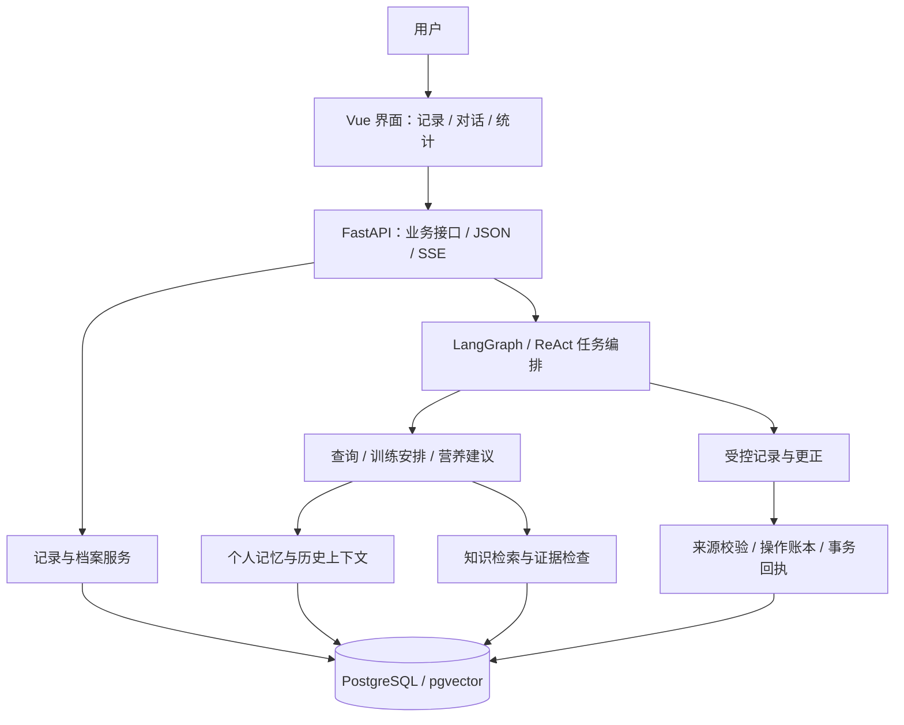

# FitZen 健身助手

一个以训练和饮食数据为中心的个人健身 Agent 应用。用 **Vue 3 / TypeScript** 提供记录与统计界面，用 **FastAPI、LangGraph 和 PostgreSQL / pgvector** 连接对话、业务工具、个人记忆和知识检索。

你可以在表单里管理记录，也可以通过对话让 Agent 查询历史、记录训练和饮食、生成训练安排，再根据新的条件继续调整。记录进入业务数据库，对话保留来源，工具执行留下状态，后续回答能够使用这些已有信息。

项目围绕三个问题展开：

- **数据怎么用起来**：训练、饮食、档案和统计共用业务数据，Agent 通过工具读取与操作。
- **对话怎么连续下去**：近期窗口、按需历史和有效记忆共同提供上下文，补充条件可以继续作用于已有任务。
- **结果怎么核对**：保存回执、引用来源、执行账本和评测入口让执行结果可检查。

## 功能

| 模块 | 可以做什么 |
| --- | --- |
| 训练记录 | 管理训练动作、逐组重量与次数、日期、训练会话；编辑和删除已有记录 |
| 饮食记录 | 查询食物、计算份量与营养、记录餐次、查看营养汇总 |
| 数据统计 | 查看训练量、动作最佳表现、摄入与消耗等数据 |
| AI 工作区 | 多会话对话、查询已保存数据、调用记录工具、回答训练和营养问题 |
| 训练安排 | 生成结构化计划预览，基于已有条件和新回复调整内容 |
| 个人信息 | 管理身高、体重、目标、经验等档案字段 |
| 记忆与 Wiki | 读取有来源的事实、会话历史和页面；支持事实更正与版本检查 |
| 系统与质量 | 查看服务状态、提交回答反馈、审核案例、运行本地离线评测任务 |

可以尝试的对话输入：

```text
记录今天深蹲 60kg，5次，3组
午餐吃了150克米饭和100克鸡胸肉，帮我记录
查询我最近一周的训练记录
根据我的训练经验安排一套上肢训练
器械只有哑铃，调整一下这份安排
```

这些是使用示例，实际执行仍取决于信息是否完整、模型与数据库是否可用，以及相应工具是否通过校验。

## 架构



前端既提供手工记录入口，也承载 Agent 对话。后端将业务数据访问、任务编排、记忆和模型网关分开；工具可以通过 MCP 桥接，支持受控的本地处理路径。

PostgreSQL 保存业务记录、记忆及执行状态，pgvector 支持向量检索。Redis 用于会话缓存与兼容记忆路径；连接不可用时，相关路径会报告降级状态。

## Agent 如何执行任务

ReAct 图包含准备、主管决策、工具执行、完成检查和收尾节点。工具结果返回给主管，完成检查决定结束还是继续处理剩余目标。

```text
准备上下文 → 主管选择工具 → 执行并返回结果 → 检查目标完成情况
                    ↑                         │
                    └────── 仍需推进 ──────────┘
                                              ↓
                                           收尾回复
```

当前工具按能力分为三组：

| 能力 | 工具 |
| --- | --- |
| 读取已有数据 | `read_profile`、`read_workout_history`、`read_nutrition_summary`、`read_current_plan` |
| 生成建议与预览 | `answer_training`、`advise_nutrition`、`plan_training` |
| 产生业务写入 | `record_workout`、`record_nutrition`、`correct_workout` |

模型负责提出工具调用，应用校验身份、来源、参数和预算。记录工具引用用户消息中的原文区间，应用再解析与核对业务字段；不能只凭模型生成的一组参数决定保存。

执行有调用次数、Token、步数与期限限制。记录成功依赖真实提交证明；重复请求由幂等身份和账本核对。提交结果未知时保留未知状态，避免把一次不确定的写入重新当作新操作执行。

对应实现：[ReAct 图](backend/app/services/agent/react_graph.py)、[工具目录](backend/app/services/agent/react_tools.py)、[执行账本](backend/app/services/agent/execution_ledger_store.py)、[MCP 桥接](backend/app/services/mcp/client.py)。

## 记忆与上下文

### 近期对话与按需历史

当前配置默认读取本会话最近 **10 轮**已完成、未隐藏或删除的对话，近期正文预算为 **12,000 tokens**。每轮保留完整的用户与助手消息，超出预算的轮次记录为省略。

更早的内容通过 Wiki 目录选择与读取。选中的来源按消息身份去重，并检查会话、版本和可见性。各任务使用自己的相关来源与必要条件，近期窗口并不意味着把全部历史传给每个工具。

### 语义单元与依赖闭包

历史装配支持带有结论、对象、条件、否定、时间范围和来源的语义单元。必要单元先保留，可选内容按价值与新增 Token 成本排序；新增成本包含尚未装入的整条依赖闭包，共用依赖只计算一次。

结构化记录使用已有字段；非结构化内容通过有界模型调用提取，逐项核对原文引文和来源。无法验证时回退到完整原页。来源校验能够约束引用，但不能证明模型绝不会遗漏语义。

时间敏感单元支持温和的时间衰减；稳定事实与必要来源保持原权重。时间权重用于排序，事实是否有效仍由版本、来源与生命周期状态决定。

### 事实与临时状态

长期事实绑定来源消息与版本，临时条件具有会话范围和有效期。读取时先计算有效状态；同一字段出现未解决冲突时保留冲突信息，过期或已替代内容不直接作为当前事实使用。

实现入口：[近期窗口](backend/app/services/memory/recent_window.py)、[单元提取](backend/app/services/memory/semantic_units.py)、[预算选择](backend/app/services/memory/selection.py)、[生命周期](backend/app/services/memory/lifecycle.py)。

## 知识检索

知识问答使用 BM25 与向量召回，经过 **RRF 融合、重排、来源还原与证据检查**后进入回答流程。仓库提供公开知识种子及来源信息，覆盖训练、营养、恢复和运动健康等主题。

证据检查区分一致、同条件冲突、适用条件差异、时间或版本差异，以及证据不足。模型返回的片段 ID 和引文必须能在本次检索结果中核对。

embedding 或重排服务不可用时，检索路径按配置降级并记录原因。降级结果与正常模型结果分别标记，便于观察召回方式和回答依据。

实现入口：[统一检索](backend/app/services/rag/retrieval.py)、[证据关系](backend/app/services/rag/evidence_conflict.py)、[知识种子](backend/seed/README.md)。

## 模型调用与预算

模型网关统一处理结构化输出、Schema 校验、有界纠错、调用计量和错误返回。发送前检查完整请求，包括消息、工具定义、输出 Schema、工具结果和纠错内容。

仓库当前配置的上下文窗口为 **65,536 tokens**，默认输出上限 **4,096**，安全余量 **15%**。窗口容量与累计调用预算分别生效；纠错和重试也需要使用剩余额度。

容量不足时按依赖关系移除可选完整内容，必要来源无法容纳则明确报告不足。估算计数与供应商实际 usage 分别记录。配置由 `backend/runtime-settings.json` 和后端配置模块管理，实际运行状态可通过 `/api/health` 查询。

## 反馈、观测与评测

后端提供回答反馈、案例审核、运行概览和模型预算查询接口，并带有两个本地页面：

| 入口 | 用途 |
| --- | --- |
| `/api/quality` | 查看与审核质量案例 |
| `/api/evaluation` | 启动固定的离线检查任务、查看任务状态和报告 |

评测任务使用预设参数启动子进程，限制并发、运行时间与日志长度，支持取消。任务入口限制本机访问，环境中关闭模型供应商和后台记忆处理。当前任务包括场景数据校验、场景模拟、离线检索与代理策略实验。

这些入口用于检查工程行为和离线策略。真实模型的回答质量、任务成功率、耗时和成本，需要另外运行相应评测；本介绍不从代码存在推导通过率。

实现入口：[质量接口](backend/app/api/quality.py)、[评测接口](backend/app/api/evaluation.py)、[固定任务执行器](backend/app/services/evaluation_jobs.py)。

## 快速开始

项目 CI 使用 **Python 3.12 与 Node 24**。应用数据服务使用 **PostgreSQL 16 + pgvector**，仓库提供 Docker Compose 配置；Redis、MCP 和模型服务按需配置。

Windows PowerShell，在项目根目录安装依赖：

```powershell
py -3.12 -m venv backend/.venv
backend/.venv/Scripts/python.exe -m pip install -r backend/requirements.txt
backend/.venv/Scripts/python.exe -m pip install --no-deps --no-build-isolation -e backend
backend/.venv/Scripts/python.exe -m pip check
npm ci --prefix frontend
```

按照[安装与启动说明](docs/getting-started.md)配置自己的数据库和模型凭证，然后在两个终端分别运行：

```powershell
# API
backend/.venv/Scripts/python.exe -m uvicorn app.main:app --app-dir backend --host 127.0.0.1 --port 8001

# 前端
npm --prefix frontend run dev -- --host 127.0.0.1
```

打开前端 `http://127.0.0.1:5173`；API 健康检查为 `http://127.0.0.1:8001/api/health`。数据库初始化失败时，应用拒绝启动。真实凭据保存在本机配置中，不写入前端或提交到仓库。

## 常用检查

```powershell
# 核心业务回归、前端测试、类型检查与隔离构建
backend/.venv/Scripts/python.exe scripts/check_project.py --smoke

# 常规本地测试套件
backend/.venv/Scripts/python.exe scripts/check_project.py

# 仅前端检查
backend/.venv/Scripts/python.exe scripts/check_project.py --only frontend

# 发布文件与固定资产检查
backend/.venv/Scripts/python.exe scripts/export_release.py --check
```

检查入口生成独立日志、JUnit 与退出码。常规后端检查使用受控测试环境；PostgreSQL 集成使用单独的 `--postgres-integration` 入口，要求非生产端点及临时库建删权限。条件跳过与实际通过分别统计。

## 代码导航

| 路径 | 职责 |
| --- | --- |
| `frontend/src/fitzen/` | 页面、聊天状态、记录交互与统计 |
| `frontend/src/components/ui/` | 共用界面组件 |
| `backend/app/api/` | 业务、聊天、Wiki、质量与评测接口 |
| `backend/app/services/agent/` | 语义理解、任务编排、工具执行与计划预览 |
| `backend/app/services/memory/` | 对话历史、事实、临时状态与上下文装配 |
| `backend/app/services/rag/` | 知识入库、检索、重排和证据检查 |
| `backend/app/services/llm/` | 模型网关、结构化输出与计量 |
| `backend/app/db/` | 业务记录、记忆和执行账本 |

## 当前边界

- 当前采用本地单用户语义，尚未接入登录认证，不适合直接作为公网多用户服务运行。
- 聊天可以生成训练计划预览，但没有保存正式计划的工具；档案修改和记录删除通过相应业务界面操作。
- 已保存训练的对话更正目前限动作名；设备同步、食物照片识别等能力尚未接入。
- 模型输出、记忆提取和证据判断仍可能出错；结构与来源校验只能覆盖其中一部分风险。
- 健康内容用于一般信息参考，不能替代专业诊断。

项目使用 [MIT 许可证](LICENSE)。第三方字体、知识资料及离线词表的许可与归属见[第三方声明](THIRD_PARTY_NOTICES.md)。
